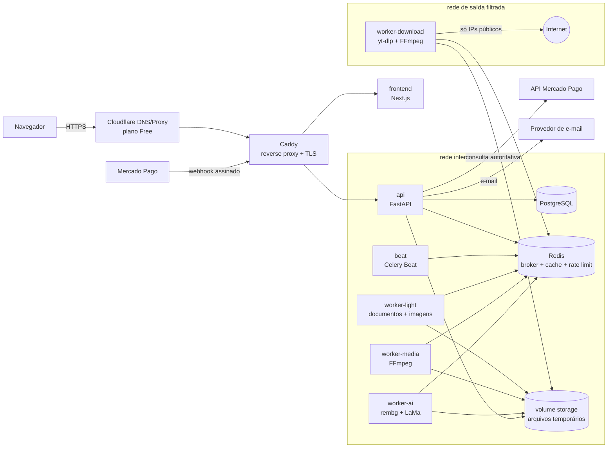

# 01 — Arquitetura

> Fase 1 · elaborado em 17/10/2026. Decisões de negócio: `docs/PRD.md` sempre vence.

## 1. Visão geral

Monólito modular (um backend FastAPI, um frontend Next.js) com processamento pesado em **workers Celery separados por tipo de carga**, tudo em Docker Compose numa única máquina. Separação lógica: web, API, banco, fila e workers são contêineres distintos com redes Docker distintas.

## 2. Componentes e responsabilidades

| Componente | Responsabilidade | Não faz |
|---|---|---|
| `frontend` (Next.js) | UI pt-BR, SSR das páginas públicas (SEO), dashboard, upload direto à API | Nunca calcula preço, saldo ou status de pagamento |
| `api` (FastAPI) | Auth, sessões, catálogo, registry de ferramentas, fichas (reserva/confirmação/devolução), criação de jobs, webhooks, admin, links assinados | Não processa arquivos pesados |
| `worker-light` | LibreOffice, Pandoc, libvips/Pillow | Sem acesso à internet |
| `worker-media` | FFmpeg (áudio/vídeo) | Sem acesso à internet |
| `worker-ai` | rembg (fundo), LaMa ONNX (inpainting); modelo carregado 1× por processo | Sem acesso à internet (modelos embutidos na imagem) |
| `worker-download` | yt-dlp atrás de adaptador; única saída para a internet, com filtro de IPs privados | Não acessa Postgres nem a API |
| `beat` | Tarefas agendadas: expiração de fichas, limpeza de arquivos, reconciliação de pagamentos, renovação/lembretes | — |
| `db` (PostgreSQL) | Fonte da verdade (usuários, fichas, ledger, pagamentos, jobs) | — |
| `redis` | Broker Celery, progresso de jobs, rate limit, cache curto | Não guarda nada que não possa ser perdido (exceto fila em trânsito, com AOF) |
| `caddy` | TLS automático, cabeçalhos de segurança, limite de corpo, roteamento | — |

Os workers **não escrevem no banco diretamente**: ao terminar, publicam o resultado e a API/um callback interno confirma ou devolve a ficha. Exceção aceitável (decisão da Fase 2): workers *light/media/ai* podem atualizar `processing_jobs` via função de serviço compartilhada, desde que a operação de ficha passe sempre pelo mesmo serviço transacional. O `worker-download` nunca acessa o banco.

## 3. Por que cada tecnologia

| Tecnologia | Motivo | Alternativa descartada |
|---|---|---|
| Next.js + TS + Tailwind | Exigido pelo CLAUDE.md; SSR ajuda SEO das páginas de ferramenta | SPA pura (pior SEO) |
| FastAPI + Pydantic | Validação forte de entrada, OpenAPI automático, async para I/O | Django (mais pesado para o que precisamos) |
| SQLAlchemy 2 + Alembic | ORM maduro, `SELECT … FOR UPDATE` explícito para fichas; migrações versionadas | — |
| PostgreSQL | Transações ACID, constraints (`CHECK`, `UNIQUE` parcial), locks de linha — essenciais para o ledger | SQLite (concorrência fraca) |
| Redis | Broker + rate limit + progresso num só serviço | RabbitMQ (mais um serviço) |
| **Celery** | Roteamento por fila (light/media/ai/download), `time_limit`/`soft_time_limit`, `acks_late`, retries e Beat embutidos | RQ/Dramatiq/arq: mais simples, mas sem Beat embutido e com roteamento/limites menos completos. Justificativa: as 4 filas com limites distintos e as tarefas agendadas tornariam a alternativa "mais simples" mais complexa no total |
| Caddy | HTTPS automático (Let's Encrypt) com config mínima | Nginx + certbot (mais peças) |
| Docker Compose | Exigido; uma máquina; redes isoladas por contêiner | Kubernetes (fora de escopo) |
| ONNX Runtime (CPU) | Roda rembg e LaMa sem PyTorch completo, imagem menor, ARM64 suportado | PyTorch (imagem de vários GB) |

## 4. Fluxo de um job cobrável (resumo)

1. API valida a entrada **antes** de cobrar (tamanho, assinatura do arquivo, combinação `available`, URL passa no SSRF). Inválido → erro, sem cobrança.
2. API reserva a ficha numa transação (lock de linha) com chave de idempotência e cria `processing_jobs`.
3. Job vai para a fila correta com `time_limit`.
4. Worker processa em diretório temporário, com timeout e limites de recursos, e grava o resultado no `StorageProvider`.
5. Sucesso → confirma a reserva. Falha do sistema → devolve. Cancelamento do usuário / entrada inválida descoberta durante o processamento → regra do PRD §2 (detalhes em `05-ciclo-de-fichas.md`).
6. Usuário baixa por link temporário assinado; arquivos são apagados após `FILE_RETENTION_HOURS`.

## 5. Extensibilidade (registry de ferramentas)

Nova ferramenta = nova linha em `tool_definitions` + `tool_capabilities` + um módulo em `backend/app/tools/<tool>/` implementando a interface `ToolHandler` (validar → estimar custo → executar). Auth, fichas, pagamentos e dashboard não mudam. Detalhes em `07-formatos-e-ferramentas.md`.

## 6. Deliberadamente fora do MVP

| Fora | Motivo |
|---|---|
| GPU | Orçamento zero; CPU basta com limites de tamanho |
| Kubernetes / microserviços | Uma máquina; complexidade sem ganho |
| Processamento em lote, API pública, app mobile, outros idiomas | PRD §10 |
| ImageMagick | Histórico de vulnerabilidades; libvips + Pillow cobrem os formatos de lançamento |
| Armazenamento S3 | Interface pronta, mas disco local no MVP |
| Adaptadores por plataforma de vídeo, cookies/login em redes sociais, DRM | PRD §6.1 |
| Pix Automático | Exige CNPJ (ver `06-pagamentos-mercado-pago.md`) |
| Alta disponibilidade / réplicas | Uma máquina gratuita; risco aceito e documentado |
