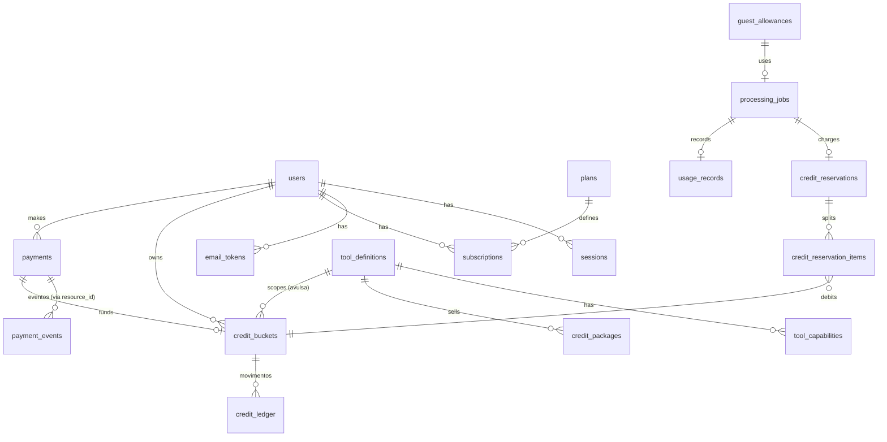

# 04 — Banco de dados (PostgreSQL)

> Fase 1 · 17/10/2026. Esquema-alvo; as migrações Alembic da Fase 2 implementam isto. Tipos: `uuid` (PK geradas no servidor), `timestamptz` sempre em UTC (conversão para `America/Sao_Paulo` só na borda), dinheiro em **centavos inteiros** (`integer`), nunca `float`.

## 1. Diagrama (principais relações)



## 2. Tabelas

### Identidade

**`users`** — `id`, `email citext UNIQUE`, `email_verified_at`, `password_hash` (Argon2id), `display_name`, `role` (`user`|`admin`), `status` (`active`|`suspended`|`pending_deletion`|`deleted`), `created_at`, `updated_at`, `deleted_at`.
- Exclusão LGPD: anonimiza PII (`email` → hash irreversível), mantém ledger/pagamentos por obrigação contábil.

**`sessions`** — `id`, `user_id FK`, `token_hash UNIQUE` (SHA-256 do token do cookie; o token em claro nunca vai ao banco), `created_at`, `last_seen_at`, `expires_at`, `revoked_at`, `ip_hash`, `user_agent`. Índice `(user_id) WHERE revoked_at IS NULL`.

**`email_tokens`** — `id`, `user_id`, `purpose` (`verify_email`|`reset_password`|`change_email`), `token_hash UNIQUE`, `expires_at`, `used_at`. Uso único.

**`terms_acceptances`** — `id`, `user_id NULL`, `guest_allowance_id NULL`, `document` (`terms`|`privacy`|`video_rights`|`image_edit_rights`), `version`, `accepted_at`, `ip_hash`, `job_id NULL`. Registro do aceite exigido pelo PRD §6.1/§6.4.

### Catálogo (editável pelo admin, sem deploy)

**`plans`** — `id`, `code UNIQUE` (`free`|`pro`|`premium`|`lifetime`), `name`, `kind` (`free`|`recurring`|`lifetime`), `price_cents`, `currency` (`BRL`), `credits_per_cycle NULL`, `is_unlimited bool`, `active`, `updated_at`. CHECK `kind='recurring' ⇒ credits_per_cycle > 0`.

**`credit_packages`** — `id`, `code UNIQUE`, `tool_id FK`, `credits` (10), `price_cents`, `validity_days` (90), `active`.

**`tool_definitions`** — `id text PK` (`video_downloader`…), `display_name`, `package_display_name`, `credit_cost int CHECK > 0` (padrão 1), `enabled`, `queue`, `sort_order`.

**`credit_cost_rules`** (✅ D1) — `id`, `tool_id FK`, `category NULL` (ex.: `video`), `min_duration_seconds NULL` (ex.: 121), `cost int CHECK > 0`, `priority`, `active`. A regra ativa mais específica que casar define o custo; sem regra → `tool_definitions.credit_cost`. Seeds: `converter`+`video` → 2; `video_downloader`+`min_duration_seconds=121` → 2.

**`tool_capabilities`** — `id`, `tool_id FK`, `category`, `input_format`, `output_format`, `status` (`available`|`planned`|`unsupported`), `engine`, `max_input_bytes NULL` (override do `system_settings`), `options_schema jsonb`, `notes`, `last_tested_at`. `UNIQUE (tool_id, input_format, output_format)`. A API só aceita jobs para `status='available'`.

### Assinaturas

**`subscriptions`** — `id`, `user_id`, `plan_id`, `kind` (`recurring`|`lifetime`), `status` (`pending`|`active`|`past_due`|`canceled`|`expired`|`refunded`), `renewal_mode` (`card_auto`|`manual`|`one_time`), `provider_preapproval_id UNIQUE NULL`, `current_period_start`, `current_period_end NULL` (NULL no vitalício), `cancel_at_period_end bool`, `next_plan_id NULL` (troca no próximo ciclo), `created_at`, `canceled_at`.
- `UNIQUE (user_id) WHERE kind='recurring' AND status IN ('active','past_due')` — no máximo uma recorrente viva.
- `UNIQUE (user_id) WHERE kind='lifetime' AND status='active'`.

**`subscription_cycles`** — `id`, `subscription_id`, `cycle_number`, `period_start`, `period_end`, `payment_id UNIQUE`, `created_at`. `UNIQUE (subscription_id, cycle_number)`. Cada ciclo pago gera exatamente um bucket de plano.

### Fichas

**`credit_buckets`** — um "saco" de fichas com origem, escopo e validade.
| Coluna | Observação |
|---|---|
| `id`, `user_id` | |
| `kind` | `daily` \| `plan` \| `package` \| `compensation` |
| `tool_id NULL` | NULL = qualquer ferramenta; obrigatório em `package` |
| `source_payment_id NULL`, `subscription_cycle_id NULL` | origem |
| `period_key` | `daily`: data local `2026-10-17`; `plan`: id do ciclo; `package`: id do pagamento |
| `granted int CHECK > 0`, `available int CHECK >= 0`, `reserved int CHECK >= 0` | CHECK `available + reserved <= granted` |
| `valid_from`, `expires_at` | |
| `status` | `active` \| `expired` \| `revoked` |

- `UNIQUE (user_id, kind, period_key)` → concessão idempotente (dois requests no mesmo dia não criam dois buckets diários; webhook repetido não cria dois buckets).
- Índice de consumo: `(user_id, status, expires_at) WHERE status='active'`.

**`credit_reservations`** — `id`, `user_id`, `job_id UNIQUE`, `idempotency_key`, `amount`, `status` (`reserved`|`committed`|`released`), `created_at`, `resolved_at`. `UNIQUE (user_id, idempotency_key)`.

**`credit_reservation_items`** — `reservation_id`, `bucket_id`, `amount`. PK composta. Permite custo > 1 dividido entre buckets.

**`credit_ledger`** — **append-only**.
| Coluna | Observação |
|---|---|
| `id bigint identity` | ordem total |
| `user_id`, `bucket_id` | |
| `entry_type` | `grant` \| `reserve` \| `commit` \| `release` \| `expire` \| `revoke` \| `adjust` |
| `delta_available int`, `delta_reserved int` | ex.: reserve = (−1, +1); commit = (0, −1); release = (+1, −1) |
| `reservation_id NULL`, `payment_id NULL`, `job_id NULL` | rastreio |
| `actor` | `system` ou id do admin |
| `reason` | texto curto |
| `created_at` | |

Proteção append-only: (1) o papel de banco da aplicação recebe só `INSERT, SELECT` (sem `UPDATE/DELETE`); (2) trigger `BEFORE UPDATE OR DELETE` que lança exceção (vale até para o dono). Correção = nova linha `adjust` ou `revoke`.

### Pagamentos

**`payments`** — `id` (também usado como `external_reference` no Mercado Pago), `user_id`, `purpose` (`package`|`plan_cycle`|`lifetime`), `package_id NULL`, `plan_id NULL`, `subscription_id NULL`, `amount_cents` e `currency` (**snapshot do preço no servidor** no momento da criação), `provider` (`mercadopago`), `provider_payment_id UNIQUE NULL`, `provider_preference_id NULL`, `status` (`created`|`pending`|`approved`|`rejected`|`cancelled`|`expired`|`refunded`|`charged_back`|`in_mediation`), `status_detail`, `method` (`pix`|`credit_card`|`debit_card`|`account_money`|…), `approved_at`, `fulfilled_at` (concessão feita), `refunded_amount_cents`, `created_at`, `updated_at`.
- Concessão só se o pagamento consultado na API do MP tiver `status=approved`, `transaction_amount = amount_cents/100` e `currency_id = BRL`.

**`payment_events`** — `id`, `provider`, `dedup_key UNIQUE` (`x-request-id`; fallback `topic:resource_id:action`), `topic`, `action`, `resource_id`, `signature_valid bool`, `received_at`, `processed_at`, `attempts`, `last_error`, `payload jsonb` (sem dados de cartão). Eventos com assinatura inválida são gravados (auditoria) mas nunca processados.

### Processamento

**`processing_jobs`** — `id`, `user_id NULL`, `guest_allowance_id NULL` (CHECK: exatamente um preenchido), `tool_id`, `capability_id`, `status` (`queued`|`processing`|`completed`|`failed`|`expired` — `expired` = resultado apagado após a retenção; **sem `canceled`**: não há cancelamento pelo usuário, decisão D12), `idempotency_key`, `input_meta jsonb` (tamanho, MIME detectado, nome sanitizado), `options jsonb` (validado contra `options_schema`), `input_key`, `output_key`, `output_expires_at`, `progress smallint`, `error_code`, `error_class` (`user_input`|`system`|`timeout`), `queue`, `task_id`, `created_at`, `started_at`, `finished_at`.
- `UNIQUE (user_id, idempotency_key)`; índice `(status, created_at)` para varredura de jobs presos.

**`usage_records`** — `id`, `user_id NULL`, `guest_allowance_id NULL`, `tool_id`, `job_id UNIQUE`, `credits_charged`, `charged_from` (`daily`|`plan`|`package`|`lifetime`|`guest`), `input_bytes`, `duration_ms`, `created_at`. Índice `(user_id, created_at)` — base do histórico e do teto diário do vitalício.

**`guest_allowances`** — `id`, `anon_id_hash UNIQUE` (HMAC do id do cookie anônimo), `ip_hash` (HMAC do IP com segredo), `status` (`available`|`reserved`|`consumed`), `job_id NULL`, `created_at`, `consumed_at`. Índice `(ip_hash, created_at)`.

### Operação

**`audit_events`** — append-only (mesma proteção do ledger): `id`, `actor_type`, `actor_id`, `action`, `target_type`, `target_id`, `ip_hash`, `metadata jsonb`, `created_at`. Logins, mudanças de admin, ajustes de fichas, estornos.

**`feature_flags`** — `key PK`, `enabled`, `rules jsonb`, `description`, `updated_by`, `updated_at`.

**`system_settings`** — `key PK`, `value jsonb`, `description`, `updated_by`, `updated_at`. Ex.: limites de tamanho, `lifetime_max_concurrent_jobs` (2), `lifetime_daily_cap` (50), `lifetime_max_seats`, `guest_max_per_ip_per_day`, `file_retention_hours`, `credit_consumption_order`.

## 3. Como o saldo é calculado

Saldo disponível para a ferramenta *T* agora:

```sql
SELECT kind, SUM(available)
FROM credit_buckets
WHERE user_id = :u AND status = 'active'
  AND valid_from <= now() AND expires_at > now()
  AND (tool_id IS NULL OR tool_id = :t)
GROUP BY kind;
```

O ledger é a trilha de auditoria; a coluna `available`/`reserved` do bucket é o valor materializado. **Invariante:** para todo bucket, `available = Σ delta_available` e `reserved = Σ delta_reserved` do ledger. Uma tarefa diária de reconciliação verifica a invariante e alerta (nunca "conserta" sozinha).

Vitalício ativo: não consulta buckets; aplica limites de uso justo.

## 4. Proteção contra concorrência

Toda operação de fichas de um usuário roda numa transação que começa com:

```sql
SELECT id FROM users WHERE id = :u FOR UPDATE;   -- mutex por usuário
```

Depois: cria bucket diário com `INSERT … ON CONFLICT DO NOTHING`, seleciona buckets elegíveis na ordem de consumo, decrementa, grava ledger e reserva, `COMMIT`. Requisições concorrentes do mesmo usuário são serializadas; usuários diferentes não se bloqueiam.

Camadas de defesa:
1. Lock de linha por usuário (serializa).
2. `CHECK (available >= 0)` e `CHECK (available + reserved <= granted)` — mesmo com bug, o banco recusa saldo negativo.
3. `UNIQUE (user_id, idempotency_key)` — reenvio do mesmo request devolve a mesma reserva.
4. `UNIQUE (user_id, kind, period_key)` e `UNIQUE (provider_payment_id)` — concessões não duplicam.
5. Teste real de concorrência na Fase 2: N requisições paralelas com saldo 1 → exatamente 1 sucesso (ver `09-testes.md`).
