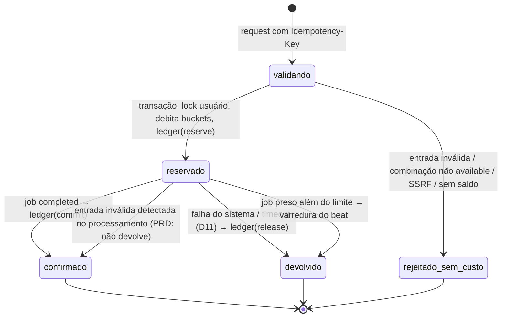
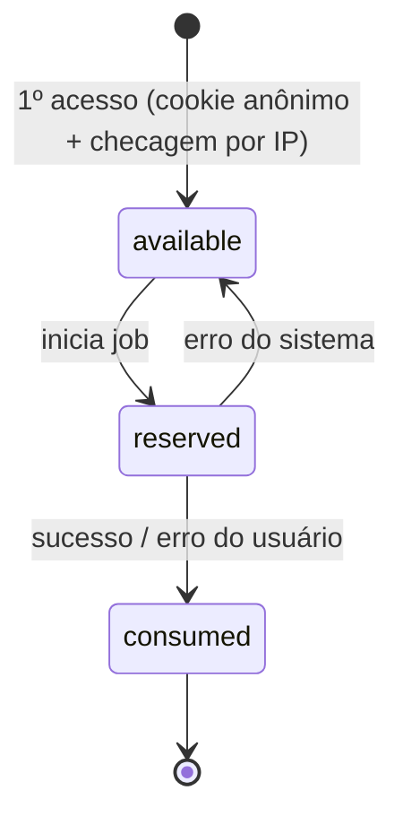

# 05 — Ciclo de vida das fichas

> Fase 1 · 17/10/2026. Regras do PRD §2–§5 e §8. Atualizado com as decisões dos sócios de 17/10/2026 (✅, códigos em `12-riscos-e-decisoes-abertas.md`).

## 1. Fontes de fichas

| Fonte | Bucket | Quantidade | Escopo | Válido de → até | Concessão |
|---|---|---|---|---|---|
| Visitante | — (`guest_allowances`) | 1, uma única vez | qualquer ferramenta | sem expiração | ao primeiro uso, se passar no anti-abuso |
| Diária (conta cadastrada **sem assinatura Pro/Premium ativa**) | `daily` | 5 | qualquer | 00:00 → 24:00 `America/Sao_Paulo` | **preguiçosa**: criada no 1º acesso do dia (`ON CONFLICT DO NOTHING`); sem cron de "reset" |
| Plano Pro/Premium | `plan` | 300 / 800 | qualquer | `period_start` → `period_end` do ciclo | quando o pagamento do ciclo é confirmado por webhook |
| Avulsa | `package` | 10 | **só a ferramenta comprada** | `approved_at` → `approved_at + 90 dias` | quando o pagamento é confirmado por webhook |
| Compensação | `compensation` | a devolvida | mesmo escopo da original | 24 h | devolução de ficha cujo bucket expirou (ver §6) |
| Vitalício | — | sem contagem | todas | vida útil do produto (Termos) | quando o pagamento único é confirmado |

✅ **Diária para assinantes (D3b):** assinantes Pro/Premium com assinatura `active` (ciclo vigente) **não** recebem diárias (em `past_due`, sem ciclo pago, voltam a receber); recebem só as do plano. A concessão preguiçosa verifica a assinatura antes de criar o bucket. Se o usuário assinar no meio do dia, o bucket diário já criado continua válido até 00:00 (não é revogado). Vitalício também não recebe diárias (não usa fichas).

**Ciclo do plano** (✅ D2): ancorado na data de início/renovação. `period_end = period_start + 1 mês de calendário` (15/01 → 15/02; 31/01 → 28 ou 29/02, com "clamp" no último dia do mês). Isso dá 28–31 dias conforme o mês. Renovação antecipada (Pix manual pago antes do fim) **não** encurta o ciclo atual: o novo começa em `period_end` do anterior.

## 2. Ordem de consumo

✅ (D3, PRD §4): `daily` → `compensation` → `plan` → `package` (da ferramenta; entre vários, o que expira primeiro). Configurável em `system_settings.credit_consumption_order`.

Caso de borda aceito: um pacote avulso comprado há 89 dias expira antes do bucket do plano, mas pela ordem fixa o plano é gasto primeiro.

## 2.1 Custo em fichas (✅ D1)

Custo = regra mais específica que casar, senão `tool_definitions.credit_cost` (padrão 1). Regras em `credit_cost_rules` (ver `04`):

| Ferramenta | Condição | Custo |
|---|---|---|
| `converter` | capacidade de categoria `video` | 2 |
| `video_downloader` | duração informada pelo extrator > 120 s | 2 |
| demais | — | 1 |

O custo é calculado **no backend antes da reserva**, exibido ao usuário e gravado em `credit_reservations.amount` (snapshot). Se o custo depender de metadado (duração), o metadado vem da consulta real do extrator, nunca do cliente.

## 3. Reserva → confirmação → devolução

Movimentos no bucket (`available`, `reserved`):

| Evento | `delta_available` | `delta_reserved` |
|---|---|---|
| grant | +N | 0 |
| reserve | −c | +c |
| commit | 0 | −c |
| release | +c | −c |
| expire | −available | 0 |
| revoke (estorno) | −min(available, N) | 0 |

**Idempotência:** o frontend gera `Idempotency-Key` (UUID) por clique; o backend usa `UNIQUE (user_id, idempotency_key)`. Repetir o request devolve o mesmo job, sem nova cobrança. Commit/release são idempotentes pelo status da reserva (`reserved` → só uma transição possível, feita com `UPDATE … WHERE status='reserved'`).

**Classificação de erro (`error_class`)** decide a devolução:
| Classe | Exemplos | Devolve? |
|---|---|---|
| `user_input` | arquivo corrompido que passou na assinatura, vídeo privado/removido, formato interno não suportado | Não (PRD §2) |
| `system` | crash do motor, falta de disco, worker morto, erro de storage | Sim |
| `timeout` | excedeu `time_limit` | ✅ Sim (D11) |

✅ **Não há cancelamento de job pelo usuário (D12):** não existe endpoint nem botão de cancelar; uma vez criado o job, a ficha só volta em falha do sistema ou timeout.

## 4. Visitante

Anti-abuso: cookie HttpOnly com id aleatório (guardado como HMAC); no máximo `guest_max_per_ip_per_day` novas permissões por IP (hash) por dia; rate limit por IP no Redis; sem fingerprinting. **Limitação reconhecida:** limpar cookies + trocar de IP (ex.: dados móveis) obtém nova ficha. Isso é aceito: o custo de 1 operação é baixo.

## 5. Vitalício (uso justo ✅ D4, PRD §8)

Sem buckets e sem ledger de fichas. Antes de criar o job: (a) `queued/processing` do usuário < `lifetime_max_concurrent_jobs` (= 2); (b) `usage_records` do dia local < `lifetime_daily_cap` (= 50); (c) mesmos limites de tamanho dos demais. Excedeu → erro claro, sem cobrança. Os valores ficam em `system_settings` e podem ser revisados a cada 6 meses (Termos). Lote limitado: `lifetime_max_seats` em `system_settings` (quantidade a definir pelos sócios); a venda é bloqueada no backend ao atingir o limite.

## 6. Expiração

Tarefa do `beat` a cada 5 min: buckets `active` com `expires_at <= now()` → ledger `expire` (−available) e `status='expired'`. O saldo consultado já ignora buckets vencidos mesmo antes da tarefa rodar (filtro por `expires_at`).

Fichas **reservadas** no momento da expiração continuam reservadas: o commit segue normal. Se houver **devolução** depois que o bucket venceu (ex.: job iniciado 23:59 falha 00:01), a ficha volta e expira na hora; para não punir o usuário por falha nossa, cria-se um bucket `compensation` de 24 h com o mesmo escopo (ledger `release` + `expire` + `grant`).

## 7. Pagamentos e estornos

| Evento | Efeito |
|---|---|
| Avulso aprovado (webhook + consulta à API) | `grant` 10 no bucket `package` (idempotente por `payment_id`) |
| Ciclo do plano aprovado | cria `subscription_cycles` + bucket `plan` (idempotente por ciclo) |
| Vitalício aprovado | `subscriptions(kind=lifetime, status=active)`; assinatura recorrente ativa passa a `cancel_at_period_end` (recomendado; sócios seguiram o padrão) |
| Estorno/chargeback de avulso | `revoke` do que restar; se já consumido, não fica negativo: registra em `audit_events` e marca a conta para revisão |
| Estorno de ciclo do plano | `revoke` do restante do bucket do ciclo; assinatura → `refunded`/`canceled` |
| Estorno do vitalício | assinatura vitalícia → `refunded`; volta a ser conta gratuita |

## 8. Troca e cancelamento de plano (✅ D5, PRD §5)

- **Troca Pro↔Premium:** grava `next_plan_id`; vale no próximo ciclo; sem pro-rata. **Na virada do ciclo com troca**, o `available` que sobrou no bucket do plano anterior é **transportado** para o novo bucket: ledger `expire` (−sobra) no bucket antigo + `grant` (+sobra, `reason='plan_change_carryover'`) no novo, além do `grant` normal do novo plano. As fichas transportadas seguem a validade do novo ciclo. Fichas reservadas no momento da virada ficam no bucket antigo (commit/release normais; release após o vencimento → `compensation`). Sem troca de plano, a sobra **não** acumula. No cartão automático, atualiza o valor da assinatura no MP para a próxima cobrança (comportamento exato da API **NÃO VERIFICADO** — testar no sandbox na Fase 4).
- **Reembolso (D5):** em até 7 dias da compra; valor proporcional às fichas não usadas do bucket do pagamento (`revoke` do restante). Fórmula e regra do vitalício: Fase 4, com texto dos Termos sob revisão jurídica.
- **Cancelamento:** `cancel_at_period_end=true`; cancela a recorrência no MP; bucket do ciclo atual permanece até `period_end`.
- **Falha na renovação por cartão:** `past_due`; nenhum bucket novo; após o período de retentativas do MP sem sucesso → `expired`. O usuário continua com as diárias e avulsas.
- **Renovação manual (Pix/débito):** lembrete por e-mail 3 dias antes e no vencimento; sem pagamento → `expired` em `period_end`.

## 9. Casos de borda (checklist de testes)

1. Dois cliques simultâneos com 1 ficha → um job, uma cobrança.
2. Mesmo `Idempotency-Key` reenviado após timeout de rede → mesmo job.
3. Webhook de aprovação entregue 3× → uma concessão.
4. Webhook chega antes do usuário voltar do checkout → concessão normal (redirect nunca concede).
5. Job inicia 23:59:59 com ficha diária e falha 00:00:05 → compensação de 24 h.
6. Usuário com avulsa de "Conversores" tenta usar o "Removedor de fundo" sem outras fichas → recusado sem custo.
7. Estorno de avulso com 7 de 10 já usadas → revoga 3, audita.
8. Admin muda `credit_cost` de 1 para 2 com job em fila → a reserva usa o custo do momento da reserva (snapshot em `credit_reservations.amount`).
9. Worker morre no meio do job → varredura detecta job `processing` além do limite → `release`.
10. Bucket de plano expira com 50 fichas sobrando → `expire` −50; novo ciclo começa com 300/800 (não acumula).
10b. Pro com 120 sobrando e troca agendada para Premium → novo ciclo com 800 + 120 = 920.
11. Usuário cancela a assinatura Premium no dia 10 do ciclo → continua com o saldo até `period_end`.
12. Vitalício dispara 3 jobs simultâneos com limite 2 → o 3º é recusado sem custo.
13. Assinante Pro ativo acessa no dia seguinte → nenhum bucket diário criado.
14. Conversão de vídeo custa 2; usuário com 1 ficha → recusado sem custo.
15. Requisição de cancelamento de job → rota inexistente (404/405).
