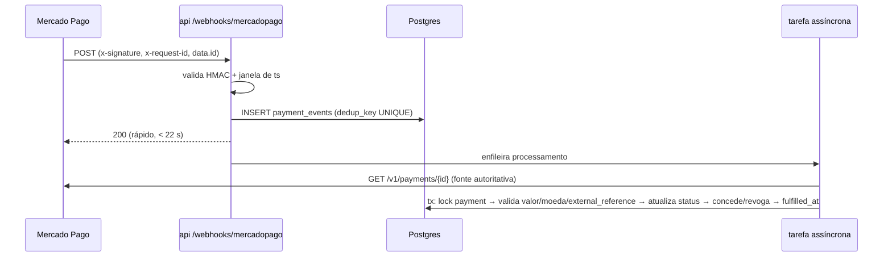

# 06 — Pagamentos (Mercado Pago)

> Fase 1 · pesquisa feita em **17/10/2026** na documentação oficial. Tudo que não foi confirmado em fonte oficial está marcado **NÃO VERIFICADO**. Taxas mudam e podem variar por conta: **confira no painel da sua conta** (Seu negócio → Custos) antes de lançar.

## 1. O que foi verificado

| Tema | Achado | Fonte (acesso 17/10/2026) |
|---|---|---|
| Taxas online | Pix **0,99%** na hora; crédito **4,98%** na hora / **4,49%** em 14 dias / **3,98%** em 30 dias; boleto R$ 3,49; saldo MP 4,99% | [mercadopago.com.br/ferramentas-para-vender/check-out](https://www.mercadopago.com.br/ferramentas-para-vender/check-out) |
| Débito online | Checkout Pro lista "cartão de crédito ou débito, Pix, boleto, Conta Mercado Pago". Checkout Transparente lista apenas **"cartão de débito virtual Caixa"** como débito. Taxa de débito em geral: **NÃO VERIFICADO** (a página só mostra 3,99% do Débito Virtual Caixa) | [Checkout Pro overview](https://www.mercadopago.com.br/developers/pt/docs/checkout-pro/overview) · [Checkout API](https://www.mercadopago.com.br/developers/pt/docs/checkout-api/payment-methods/other-payment-methods) |
| Assinaturas (API `/preapproval`) | Tipos: com plano associado; sem plano, com pagamento **autorizado** (envia `card_token_id`; cobra automaticamente no meio definido; valida cartão com cobrança mínima devolvida) ou **pendente** (pagador conclui pelo link). A página geral cita "Pix, cartão de crédito ou débito, boleto" | [Assinaturas](https://www.mercadopago.com.br/developers/pt/docs/subscriptions/overview) · [pagamento autorizado](https://www.mercadopago.com.br/developers/pt/docs/subscriptions/integration-configuration/subscription-no-associated-plan/authorized-payments) |
| Pix em assinatura recorrente automática | A documentação técnica do fluxo autorizado só mostra `card_token_id`. Se Pix renova **sem ação do pagador** via `/preapproval`: **NÃO VERIFICADO** | idem |
| **Pix Automático** | FAQ do Banco Central (via resultados de busca): recebedor deve ser **pessoa jurídica com CNPJ ativo**; não se aplica a pagamentos para pessoas físicas. Blog do MP cita CNPJ ativo há **mais de 6 meses** (o PDF do BCB não abriu aqui; o requisito de 6 meses fica **NÃO VERIFICADO** na fonte primária) | [blog MP](https://www.mercadopago.com.br/blog/pix-automatico-vender-pacotes-assinaturas) · FAQ BCB `pix-automatico-FAQ-participantes.pdf` |
| Pix (Checkout Transparente) | Expiração padrão 24 h; configurável de 30 min a 30 dias; exige chave Pix cadastrada; status `action_required/waiting_transfer` até pagar | [Pix – Orders API](https://www.mercadopago.com.br/developers/pt/docs/checkout-api-orders/payment-integration/websites/pix) |
| Webhook | Header `x-signature: ts=…,v1=…` e `x-request-id`. Manifesto `id:{data.id};request-id:{x-request-id};ts:{ts};` → HMAC-SHA256 (hex) com a assinatura secreta do painel, comparar com `v1`; omitir campos ausentes; comparar `ts` com o horário do servidor. Responder 200/201 em até **22 s**; senão reenvia a cada 15 min, depois espaça. Notificações de QR Code não têm assinatura | [Webhooks](https://www.mercadopago.com.br/developers/pt/docs/your-integrations/notifications/webhooks) |
| Tópicos | `payment`, `subscription_preapproval`, `subscription_authorized_payment`, `topic_chargebacks_wh`, `orders`… | idem |
| Reembolso | Até **180 dias** após aprovação; total (corpo vazio) ou parcial (`amount`); exige `X-Idempotency-Key`; precisa de saldo na conta | [Refunds (Checkout Pro)](https://www.mercadopago.com.br/developers/en/docs/checkout-pro/additional-settings/refunds-and-cancellations) |
| Testes | Cartões de teste; o nome do titular define o resultado (`APRO` aprovado, `OTHE` recusado, `CONT` pendente, `FUND` sem saldo) | [Cartões de teste](https://www.mercadopago.com.br/developers/pt/docs/checkout-pro/test-cards) |
| Conta PF | Venda com CPF é possível; link/checkout disponível para CPF e CNPJ. **Limites de recebimento para PF: NÃO VERIFICADO** | [blog MP: vender com MP](https://www.mercadopago.com.br/blog/tudo-que-voce-precisa-saber-para-vender-com-mercado-pago) |

## 2. Estratégia por fluxo do PRD §5

| Fluxo | Suportado? | Estratégia recomendada |
|---|---|---|
| Avulso – Pix | Sim | Checkout Pro (preferência) |
| Avulso – crédito | Sim | Checkout Pro |
| Avulso – débito | Sim no Checkout Pro (bandeiras/taxa **NÃO VERIFICADO**) | Checkout Pro |
| Plano mensal – crédito recorrente | Sim | `/preapproval` com `card_token_id` (cobrança automática) |
| Plano mensal – **Pix recorrente** | **Não para conta PF** (Pix Automático exige CNPJ) | **Plano B:** "renovação manual" — cada ciclo é um pagamento avulso via Checkout Pro (Pix/débito/crédito), com e-mail 3 dias antes e no vencimento e botão "Renovar" no dashboard |
| Plano mensal – débito recorrente | Não encontrado na documentação | Mesmo Plano B (renovação manual) |
| Vitalício | Sim | Checkout Pro, pagamento único (Pix ou crédito) |

Por que **Checkout Pro** e não Transparente no MVP: suporta débito e Conta MP; os dados de cartão nunca passam pelo nosso servidor (menor escopo PCI); menos código. Contra: o usuário sai do site para pagar. O Transparente pode entrar depois (Pix inline) sem mudar a regra de negócio, porque tudo passa pela interface `PaymentProvider`.

Quando os sócios tiverem CNPJ (ver §6), adicionar Pix Automático como `renewal_mode='pix_auto'`.

## 3. Estados e mapeamento

| Status MP (`payment.status`) | Nosso `payments.status` | Ação |
|---|---|---|
| `pending`, `in_process`, `authorized`, `action_required` | `pending` | nenhuma concessão |
| `approved` | `approved` | conceder (idempotente) |
| `rejected` | `rejected` | nada |
| `cancelled` | `cancelled` (ou `expired` se o motivo for vencimento do Pix) | nada |
| `refunded` | `refunded` | revogar (ver `05` §7) |
| `charged_back` | `charged_back` | revogar + marcar conta |
| `in_mediation` | `in_mediation` | congelar avulsas ainda não usadas do pagamento (🔶) |

Mapeamento exato de `status_detail` para "expirado": **NÃO VERIFICADO** — confirmar no sandbox.

## 4. Webhook — processamento

Regras:
1. Assinatura inválida → grava evento (`signature_valid=false`), responde 401, não processa.
2. **Nunca confia no corpo do webhook**: sempre consulta a API do MP com o access token e usa a resposta.
3. `external_reference` = nosso `payments.id`; valor e moeda conferidos contra o snapshot salvo.
4. Concessão na mesma transação que grava `fulfilled_at`; `UNIQUE` em `provider_payment_id` e no bucket impede duplicar.
5. O redirect de volta do checkout (`back_url`) só mostra "aguardando confirmação" e consulta nosso backend; **nunca concede**.

## 5. Reconciliação

- Tarefa do `beat` a cada 10 min: pagamentos `pending` com mais de 5 min → consulta a API do MP e aplica o mesmo processamento (cobre webhook perdido).
- Diário: assinaturas `active` com `current_period_end` vencido sem ciclo novo → consulta `/preapproval/{id}` e pagamentos autorizados.
- Diário: relatório de divergências (pagamento aprovado sem `fulfilled_at`, bucket sem pagamento) → alerta ao admin.

## 6. Conta de pessoa física — riscos

| Risco | Situação |
|---|---|
| Pix Automático indisponível | Confirmado: exige CNPJ (BCB) |
| Limites de recebimento PF | **NÃO VERIFICADO** — conferir no app do MP |
| Tributação | Receita recorrente de vendas em CPF tende a exigir carnê-leão/IRPF; MEI pode ser mais barato. **NÃO VERIFICADO** — consultar contador |
| Bloqueio/retenção de saldo por "atividade de risco" | Possível (especialmente com baixador de vídeos). Regras exatas **NÃO VERIFICADO** |
| Estorno sem saldo | Reembolso exige saldo disponível na conta |

Recomendação: lançar em PF é tecnicamente possível com o Plano B; planejar CNPJ (MEI ou ME) antes de escalar, para Pix Automático e para reduzir risco fiscal.

## 7. A testar no sandbox (Fase 4)

- Débito no Checkout Pro com cartão de teste.
- Assinatura `/preapproval` com cartão de teste; troca de valor (`PUT`) e efeito na próxima cobrança.
- Se `/preapproval` "pendente" aceita Pix e se cada ciclo exige ação do pagador.
- Mapeamento de expiração do Pix.
- Fluxo de reembolso e evento de chargeback.

## 8. Implementação (Fase 4, 18/10/2026)

| Fluxo | Como foi implementado | Validado |
|---|---|---|
| Avulso (Pix, crédito, débito, saldo MP) | `POST /checkout/preferences` (Checkout Pro), `external_reference` = id do nosso pagamento, boleto excluído, 1 parcela | testes com provedor simulado; **sandbox real pendente** |
| Plano mensal — cartão automático | `POST /preapproval` com `status: pending` (o usuário cadastra o cartão na página do MP; nenhum dado de cartão passa por nós) | idem; existência de `init_point` na resposta: **NÃO VERIFICADO** até o `sandbox_check` |
| Plano mensal — Pix/débito | Checkout Pro de 1 ciclo + lembrete por e-mail 3 dias antes; renovação antecipada começa no fim do ciclo atual | testes |
| Vitalício | Checkout Pro, pagamento único; lote de **50 vagas** (checkout aberto segura a vaga por 30 min) | testes |
| Webhook | HMAC-SHA256 do manifesto `id;request-id;ts`, tolerância de 300 s (anti-replay), dedup por `x-request-id`, 200 imediato e processamento assíncrono que **sempre reconsulta a API** | testes (assinatura inválida, replay, id trocado, duplicado, 5 em paralelo) |
| Concessão | só com `approved` da API + valor/moeda/referência iguais ao snapshot; `fulfilled_at` + lock de linha + UNIQUE; redirect nunca concede | testes |
| Cobrança recorrente | `subscription_authorized_payment` → `GET /authorized_payments/{id}` → pagamento → novo ciclo | formato da resposta **NÃO VERIFICADO** até o sandbox |
| Estorno/chargeback | revoga o saldo restante (lançamento compensatório); falta registrada em `audit_events` | testes |
| Reembolso (D5) | admin executa em até 7 dias; valor proporcional às fichas não usadas; `POST /v1/payments/{id}/refunds` com chave de idempotência | testes (valor 6/10 de R$ 4,90 = R$ 2,94; prazo vencido → 409) |
| Falha de renovação no cartão | `past_due` por 3 dias, depois `expired` + cancelamento no MP | testes |
| Reconciliação | a cada 10 min: eventos não processados + pagamentos pendentes há > 5 min (busca por `external_reference`); alerta para aprovado sem concessão | testes (webhook perdido recuperado) |
| Sem credenciais | pagamentos desligados (503) — nunca um checkout falso | teste + verificação manual |

Para validar no sandbox: `docs/architecture/11` §1 e `python -m app.payments.sandbox_check`.
